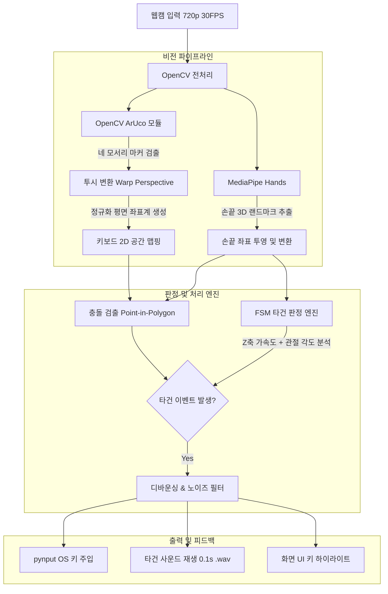

# [프로젝트 계획서] OpenCV & MediaPipe 기반 가상 평면 키보드 (CV-Type)

<aside>
⚠️

## 임시로 뽑아본 문서이니 참고만 하세요.

</aside>

## 1. 프로젝트 개요

- **프로젝트명:** CV-Type (가상 평면 키보드 시스템)
- **팀 구성:** 총 6인 (핵심 개발 2인, 환경 구축 2인, 기획 및 UX 2인)
- **목표:** 일반 웹캠 환경에서 인쇄된 자판(또는 키스킨)을 촬영하여 손가락 위치와 타건 동작을 실시간 추론하고, OS 가상 키보드 입력 신호로 변환 주입
- **핵심 기술 스택:** Python, OpenCV (ArUco 마커, 투시 변환), Google MediaPipe Hands, NumPy, pynput
- **타깃 환경:** 720p (1280×720) @ 30 FPS 기준 (CPU 구동)

## 2. 시스템 아키텍처 및 파이프라인 (Mermaid)



## 3. R&R (역할 분담 및 주요 산출물)

### 파트 1. 핵심 개발 (2인)

- **개발자 A (OpenCV & MediaPipe 비전 파이프라인):**
    - `cv2.aruco` 기반 자판 코너 실시간 검출 및 `cv2.getPerspectiveTransform` 왜곡 보정
    - MediaPipe Hands를 통한 양손 손끝(Fingertip) 3D 좌표 추출 및 정규 좌표계 변환
    - **최종 산출물:** 손끝 좌표 정규화 스트림 모듈 (`vision_tracker.py`)
- **개발자 B (타건 판정 엔진 & 시스템 통합):**
    - 손끝 Z축 변화율(\frac{dz}{dt}) 및 관절 각도 기반 유한 상태 머신(FSM) 구축
    - 키 바운딩 박스 충돌 검사, 디바운스(250ms 쿨다운) 적용, `pynput` 키 주입 연동
    - **최종 산출물:** 타건 판정 및 OS 키보드 주입 메인 루프 (`engine.py`, `main.py`)

### 파트 2. 환경 구축 & 물리 인터페이스 (2인)

- **담당자 C (자판 템플릿 & 좌표 매핑):**
    - ArUco 마커가 포함된 무반사 표준 자판 도안(A4 인쇄/키스킨 베이스) 제작
    - 각 키의 바운딩 박스 좌상단·우하단 정규 좌표 JSON 생성 (`keymap.json`)
    - **최종 산출물:** 자판 실물 패드 및 키 좌표 설정 파일
- **담당자 D (촬영 리그 & 조명 SOP):**
    - 카메라 탑뷰/쿼터뷰 안정 거치 구조물 고정 (진동 방지)
    - 그림자 및 빛 반사 왜곡을 억제하는 조명 배치 가이드(SOP) 수립
    - **최종 산출물:** 표준 촬영 거치대 및 환경 적합성 테스트 리포트

### 파트 3. 기획 & UX 피드백 (2인)

- **담당자 E (사운드 & 시각 피드백):**
    - 물리 타건감을 대체할 무지연(Zero-latency) 기계식 키보드 음원(.wav) 수집 및 가공
    - 타건 시 화면상에 표시될 가상 키보드 하이라이트 UI 규격 정의
    - **최종 산출물:** 사운드 에셋 팩 및 피드백 GUI 디자인 명세서
- **담당자 F (특수 제스처 기획 & 시연 총괄):**
    - 종이 자판 특화 제스처(전체 삭제, 모드 전환 등) 규칙 정의서 작성
    - 발표 및 부스 전시용 3단계 시연 시나리오 및 타자 연습 데모 구성
    - **최종 산출물:** 기능 명세서, 시연 대본, 최종 발표 PPT

## 4. 데이터 인터페이스 규격 (Data Protocol)

- **자판 레이아웃 정의 (`keymap.json`):**

```json
{
  "layout_name": "QWERTY_720p",
  "resolution": [1280, 720],
  "keys": [
    {"label": "Q", "bbox": [150, 200, 210, 260]},
    {"label": "W", "bbox": [220, 200, 280, 260]},
    {"label": "SPACE", "bbox": [350, 450, 750, 510]}
  ]
}
```

- **손끝 트래킹 데이터 전송 규격 (Python Dictionary):**

```python
fingertip_event = {
    "hand": "right",          # 'left' | 'right'
    "finger_idx": 8,          # 검지 손가락 끝 (MediaPipe Index 8)
    "pos_2d": [225.4, 205.1], # 자판 정규 평면 상의 픽셀 좌표
    "z_velocity": -0.015,     # Z축 하강 속도
    "joint_angle": 138.2      # PIP-DIP 관절 사잇각
}
```

## 5. 단계별 개발 일정 (4주 마일스톤)

| **주차** | **목표 마일스톤** | **핵심 개발 (2인)** | **환경 구축 & 기획 (4인)** |
| --- | --- | --- | --- |
| **1주차** | **기초 파이프라인 PoC** | ArUco 마커 검출, 사각형 4개 키 타건 콘솔 출력 | 카메라 거치대 제작, ArUco 자판 도안 1차 인쇄 |
| **2주차** | **알고리즘 정밀화** | 투시 변환 연동, Z축+각도 기반 FSM 타건 알고리즘 완성 | 전체 키 좌표 JSON 실측, 타건 효과음 에셋 확보 |
| **3주차** | **시스템 통합** | `pynput` 연동, 디바운스 필터, 효과음/GUI 브리지 결합 | 환경별(조도/각도) 오타율 측정, 제스처 규칙 확정 |
| **4주차** | **안정화 및 시연** | 인풋랙 개선, 메모장 연속 타이핑 안정화 | 시연 시나리오 리허설, 발표 슬라이드 및 포스터 제작 |

## 6. 예상 리스크 및 기술적 대응 방안

1. **단일 카메라 Z축 깊이 오차로 인한 오입력:**
    - 단순 z값 단독 판정을 배제하고, **Z축 하강 속도(\frac{dz}{dt}) 임계값 돌파 + 손가락 관절 꺾임 각도 변화**를 동시에 만족할 때만 입력으로 처리.
2. **손 떨림 및 경계면 혼선:**
    - 직전 3프레임 이동평균(Moving Average) 필터를 손끝 좌표에 적용해 좌표 튐을 억제하고, 키 바운딩 박스 중심부 가중치 판정 적용.
3. **연타 현상 (Chattering):**
    - 한 번 'Press' 판정이 난 키는 손끝이 영역을 벗어나거나 250ms가 지나기 전까지 재입력을 차단하는 소프트웨어 디바운스 타이머 적용.